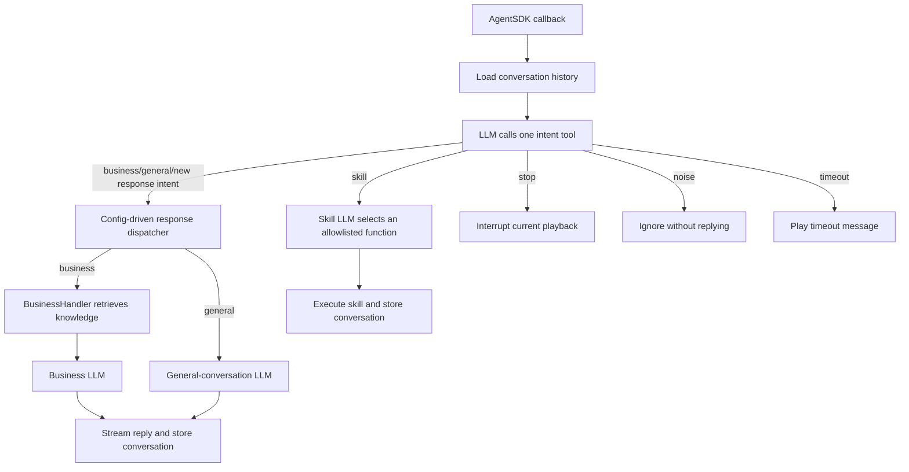

# AgentSDK Sample Code

[简体中文](README.md) | [English](README_EN.md)

This project is a reference implementation of a hospital guidance robot built with LinkSoul AgentSDK. It receives automatic speech recognition (ASR) text in the configured language, uses an LLM to route the intent, and dispatches the request to hospital guidance, general conversation, or robot skill execution.

> The sample includes Simplified Chinese and English language configurations. Each process selects one language through `locale_file` in `config.json` at startup. Runtime language detection and switching are not supported.

> **Environment:** This project uses the production LinkSoul services. Application credentials, agents, knowledge bases, and runtime settings must all come from the production environment.

## Features

- LLM function calling selects exactly one dynamically registered top-level intent tool, eliminating the need for a fixed JSON intent label.
- `BusinessHandler` explicitly retrieves hospital knowledge before the business LLM generates a response.
- The `general` route handles greetings, general-knowledge questions, and requests unrelated to hospital services.
- The application executes only the robot skills allowlisted in `config.json`.
- In-memory multi-turn context for a single robot instance.
- While the robot is speaking, new `business`, `general`, and `skill` requests are ignored; `stop` can still interrupt playback.

## Request Flow



The request-processing sequence is as follows:

1. AgentSDK passes the ASR result to the application, which loads the recent conversation history.
2. `ScopeRouter` registers the dynamic response intents and `skill/stop/noise` as parameterless function tools and requires the LLM to call exactly one. Response intents are passed to their registered handlers by the dispatcher.
3. For a `business` request, `BusinessHandler` explicitly retrieves hospital knowledge, adds the reference material to the current `user` message, and invokes the business LLM. The `general` route handles other conversational requests, while the `skill` route can execute only locally allowlisted skills.
4. The main flow handles `stop`, `noise`, and `timeout` directly. Successful replies and skill results are stored in memory for the next turn.

### Intent Routes

| Route | Meaning | Behavior |
|---|---|---|
| `business` | Hospital guidance, care procedures, in-hospital locations, and symptom-related questions | Retrieve knowledge through `BusinessHandler`, then invoke the business LLM |
| `general` | Greetings, general-knowledge questions, and requests unrelated to hospital services | Invoke the general-conversation LLM |
| `skill` | A request to perform a configured action or play music | Use function calling to select an allowlisted skill, then invoke AgentSDK |
| `stop` | A request to stop the current reply or action | Call the interrupt API without generating a new reply |
| `noise` | Noise or an ASR fragment that remains meaningless after context is considered | Ignore without replying |
| `timeout` | Intent-routing timeout, API failure, or invalid model result | Play the configured timeout message |

## Project Layout

```text
sample_code/
├── main.py                    # Application entry point and AgentSDK callbacks
├── app_config.py              # Configuration loading and validation
├── scope_router.py            # LLM intent routing and response parsing
├── route_dispatcher.py        # Response-intent registration and dispatch
├── handlers/                  # Reply handlers loaded by the dispatcher
│   ├── __init__.py
│   ├── business_handler.py
│   └── general_chat_handler.py
├── skill_handler.py           # Skill allowlist validation and execution
├── skill_config.py            # Skill configuration parsing
├── conversation_manager.py    # In-memory conversation state
├── knowledge_retriever.py     # Remote knowledge-base retrieval
├── llm_client.py              # OpenAI-compatible LLM client
├── config.json                # Technical runtime configuration
├── config/
│   ├── prompt_layout.json     # Developer-maintained prompt structure
│   └── locales/
│       ├── zh-CN.json         # Simplified Chinese prompts and messages
│       └── en-US.json         # English prompts and messages
├── knowledge_base/            # Knowledge-base files for import into LinkSoul
│   ├── hospital_qa_curated_250_zh.xlsx
│   └── hospital_qa_curated_250_en.xlsx
├── .env.example               # Environment-variable examples
├── requirements.txt           # Pinned dependencies
├── pyproject.toml             # Python project metadata
├── README.md                  # Chinese documentation
└── README_EN.md               # English documentation
```

## Requirements

- Python 3.10 or later.
- `linksoul-agentsdk==1.4.0a0`. Download the official wheel or source package and install it locally; this sample is developed and verified against this version.
- Network access to AgentSDK, an OpenAI-compatible LLM service, and the retrieval endpoint when the knowledge base is enabled.
- Simplified Chinese or English input consistent with the selected language configuration.

## Run the Application

### 1. Install dependencies

Refer to the [AgentSDK package download documentation](https://open.agibot.com/docs/linksoul/agentsdk_docs/python/v140/zh#%E5%BC%80%E5%8F%91%E5%8C%85%E4%B8%8B%E8%BD%BD), download the wheel or source package that matches the target operating system and Python version, and copy it to the deployment environment. AgentSDK must be installed from this local package; the project does not download the SDK automatically.

Create a virtual environment, install AgentSDK locally, and then install the remaining project dependencies:

```bash
cd /path/to/sample_code
python3 -m venv .venv
source .venv/bin/activate
python -m pip install --upgrade pip
python -m pip install /path/to/agentsdk-package.whl
python -m pip install -r requirements.txt
```

If you downloaded a source package, replace the AgentSDK installation command with:

```bash
python -m pip install /path/to/agentsdk-source-package
```

Replace `/path/to/agentsdk-package.whl` or `/path/to/agentsdk-source-package` with the actual local file or directory path. `requirements.txt` declares the verified AgentSDK version; when that exact version is already installed, `pip` reuses the local installation.

On Windows PowerShell:

```powershell
python -m venv .venv
.\.venv\Scripts\Activate.ps1
python -m pip install --upgrade pip
python -m pip install C:\path\to\agentsdk-package.whl
python -m pip install -r requirements.txt
```

### 2. Obtain AgentSDK credentials

Sign in to the [LinkSoul Open Platform](https://open.agibot.com/), create an application, and obtain the application credentials required by AgentSDK:

| Environment variable | Platform value |
|---|---|
| `AGIBOT_APP_ID` | Application ID |
| `AGIBOT_APP_KEY` | Application Key |
| `AGIBOT_APP_SECRET` | Application Secret |

Store these credentials securely. Do not place them in `config.json` or commit them to the Git repository. After configuring the agent in step 4, record its Agent Code as well.

### 3. Configure the LLM for each module

The project calls LLMs through an OpenAI-compatible API. Review and configure all four LLM sections in `config.json`:

| Configuration path | Purpose | API key environment variable |
|---|---|---|
| `scope_router.llm` | Top-level intent routing | `SCOPE_ROUTER_LLM_API_KEY` |
| `skill_handler.llm` | Skill selection | `SCOPE_ROUTER_LLM_API_KEY` |
| `reply_routes.general.llm` | Greetings and non-hospital conversation | `GENERAL_CHAT_LLM_API_KEY` |
| `reply_routes.business.llm` | Hospital-service and guidance responses | `BUSINESS_LLM_API_KEY` |

Each section must define `base_url`, `model`, `temperature`, `max_tokens`, and timeout settings. Set `base_url` to the API root; do not include the full `/chat/completions` path.

The `api_key_env` field in `config.json` specifies an environment-variable name; it does not contain the API key itself. Do not add or hard-code an `api_key` in the configuration file. Inject the actual keys through environment variables in step 5. If multiple modules share the same model service, their respective environment variables may be assigned the same key.

For example, configure the business-response model as follows when using an external Volcengine Ark model:

```json
{
  "provider": "openai_compatible",
  "base_url": "https://ark.cn-beijing.volces.com/api/v3",
  "api_key_env": "BUSINESS_LLM_API_KEY",
  "model": "ep-your-endpoint-id",
  "temperature": 0.1,
  "max_tokens": 512,
  "timeout_seconds": 5,
  "business_timeout_seconds": 10,
  "stream": true
}
```

For the other three LLM sections, use the same Ark `base_url` and an appropriate inference endpoint ID such as `ep-...`, while retaining the module-specific `api_key_env`, `max_tokens`, and `stream` settings. `timeout_seconds` limits the underlying HTTP request, while `business_timeout_seconds` limits how long the application waits for that call to produce a result.

`extra_body` is an optional provider-specific request body. The default configuration uses it to pass `thinking=disabled`. If the target service does not support this extension, remove the entire `extra_body` field from the corresponding LLM section.

### 4. Configure the agent and knowledge base on LinkSoul

Sign in to the [LinkSoul Platform](https://linksoul.agibot.com/zh-cn/agent), then create or select the agent that will run this sample application. Record its Agent Code and assign it to `AGIBOT_AGENT_CODE` in step 5.

First, set the top-level `locale_file` field in `config.json`. The following excerpts show only this field. For a Simplified Chinese deployment, use:

```json
{
  "locale_file": "config/locales/zh-CN.json"
}
```

For an English deployment, use:

```json
{
  "locale_file": "config/locales/en-US.json"
}
```

Next, create a hospital knowledge base and bind it to the agent. Upload only the knowledge-base file that matches the language selected by `locale_file`:

- If `locale_file` is `config/locales/zh-CN.json`, upload `knowledge_base/hospital_qa_curated_250_zh.xlsx`.
- If `locale_file` is `config/locales/en-US.json`, upload `knowledge_base/hospital_qa_curated_250_en.xlsx`.

A single-language knowledge base should contain only the file for its configured language. Confirm that the selected file has completed parsing and indexing and that the knowledge base is bound to the agent identified by `AGIBOT_AGENT_CODE`. When `reply_routes.business.knowledge_base.enabled` is `true`, `BusinessHandler` retrieves content from the knowledge base associated with that agent.

After completing the platform setup, configure retrieval under `reply_routes.business.knowledge_base` in `config.json`:

```json
{
  "reply_routes": {
    "business": {
      "knowledge_base": {
        "enabled": true,
        "api_url": "https://open.agibot.com/api/V1/open-portal/app/retriever/search/agent_kb",
        "top_k": 5,
        "rerank": true,
        "check_qa_first": true,
        "score_threshold": 0.1,
        "timeout_seconds": 5,
        "business_timeout_seconds": 5
      }
    }
  }
}
```

This excerpt shows only the knowledge-base configuration path. Merge it with the existing `handler` and `llm` settings under `business`; do not replace the entire `business` section.

| Field | Meaning |
|---|---|
| `enabled` | Enables knowledge retrieval. When set to `false`, `BusinessHandler` skips retrieval and invokes the business LLM directly |
| `api_url` | Knowledge-retrieval endpoint; it must belong to the same environment as the agent and application credentials |
| `top_k` | Maximum number of results requested for each retrieval |
| `rerank` | Requests server-side reranking of candidate results |
| `check_qa_first` | Prioritizes matching against structured Q&A entries |
| `score_threshold` | Minimum relevance threshold sent to the knowledge-base service to filter low-relevance results |
| `timeout_seconds` | Low-level HTTP timeout for the retrieval request, in seconds |
| `business_timeout_seconds` | Maximum time the application waits for the complete retrieval operation, in seconds |

Knowledge retrieval reuses `AGIBOT_APP_ID`, `AGIBOT_APP_KEY`, `AGIBOT_APP_SECRET`, and `AGIBOT_AGENT_CODE`; no separate knowledge-base credential is required.

### 5. Export environment variables and start

Linux/macOS example:

```bash
export AGIBOT_APP_ID="your_app_id"
export AGIBOT_APP_KEY="your_app_key"
export AGIBOT_APP_SECRET="your_app_secret"
export AGIBOT_AGENT_CODE="your_agent_code"
export SCOPE_ROUTER_LLM_API_KEY="your_scope_router_llm_api_key"
export GENERAL_CHAT_LLM_API_KEY="your_general_chat_llm_api_key"
export BUSINESS_LLM_API_KEY="your_business_llm_api_key"

python -m json.tool config.json >/dev/null
python -m json.tool config/prompt_layout.json >/dev/null
python -m json.tool config/locales/zh-CN.json >/dev/null
python -m json.tool config/locales/en-US.json >/dev/null
python main.py
```

`.env.example` lists variable names only; the application does not load `.env` automatically. Run the exports in the same shell that starts `main.py`, or inject the variables through your container or deployment system. Press `Ctrl+C` to stop the application.

## Verify the Application

Verify the following in order:

1. Startup produces no configuration error or Python exception.
2. The log contains `application_initialized`, meaning SDK initialization was invoked successfully.
3. The log contains `agent_auth_succeeded`, confirming that AgentSDK authentication and connection establishment succeeded.
4. After speaking a sentence, the log emits `conversation_user_input`, `conversation_intent`, and `conversation_robot_response` in sequence.
5. The robot plays a response or executes a configured skill.

If the log contains `application_initialized` but not `agent_auth_succeeded`, AgentSDK authentication has not completed. Check the application credentials from the LinkSoul Open Platform, confirm environment consistency, and verify network connectivity.

The agent page on the LinkSoul Platform provides a simulated robot conversation interface. After completing the checks above, use this interface to verify intent routing, knowledge retrieval, text responses, and skill invocation. Once the simulated conversation behaves as expected, bind the agent to the target robot and complete voice-interaction and action-execution tests on the physical device.

## Configuration

### Configuration File Responsibilities

Configuration is separated into runtime parameters, prompt structure, and language-specific content:

| File | Purpose |
|---|---|
| `config.json` | Runtime parameters for AgentSDK, LLMs, conversations, handlers, knowledge retrieval, and skill calls |
| `config/prompt_layout.json` | Prompt composition, punctuation, line structure, and placeholders maintained by developers |
| `config/locales/zh-CN.json` | Simplified Chinese intent descriptions, prompts, spoken messages, knowledge labels, and skill text |
| `config/locales/en-US.json` | The corresponding English language content |

The top-level `locale_file` field in `config.json` selects the language configuration, while `prompt_layout_file` selects the prompt-structure file. Use `config/locales/zh-CN.json` for a Simplified Chinese deployment and `config/locales/en-US.json` for an English deployment. The language is fixed at process startup and does not change per request.

Locale files contain language content and do not use program interpolation templates such as `{value}`. `prompt_layout.json` controls placeholders, punctuation, line structure, and composition order. Layout names and placeholders are validated during startup.

### Modify Prompts

Prompts are not maintained in `config.json`. Edit the language file selected for the deployment:

- Simplified Chinese: `config/locales/zh-CN.json`
- English: `config/locales/en-US.json`

| Configuration path | Purpose |
|---|---|
| `scope_router.system_prompt` / `user_prompt` | Top-level intent-routing prompts |
| `scope_router.control_routes` | Tool descriptions for `skill`, `stop`, and `noise` |
| `skill_handler.system_prompt` / `user_prompt` | Skill-selection prompts |
| `reply_routes.general.system_prompt` / `user_prompt` | General-conversation response prompts |
| `reply_routes.business.system_prompt` / `user_prompt` | Hospital-service and guidance response prompts |
| `reply_routes.business.knowledge_base` | Reference-data instruction and messages for empty or failed retrieval |
| `reply_routes.<route>.description` | Description used to generate the top-level intent function for routing |
| `skill_texts` | Skill descriptions and optional spoken text after skill execution |

`config/prompt_layout.json` defines how user input and knowledge-base excerpts are composed. Modify it only when changing placeholders, field order, or message layout. If both language editions are distributed, keep the two language files synchronized when prompts change.

### Modify Runtime Parameters and Environment Variables

- Use `config.json` to configure the language selection, AgentSDK endpoint, LLM connections, conversation limits, knowledge-retrieval parameters, and skill allowlist.
- Fields ending in `*_env` in `config.json` specify environment-variable names only; they do not store credentials or API keys.
- `.env.example` lists the required environment variables and serves only as a template. The application does not load `.env` automatically.
- Inject actual credentials and API keys through the same shell that starts `main.py`, the container configuration, or the deployment system. See step 5 under "Run the Application" for an example.

`config.json` contains:

| Section | Purpose |
|---|---|
| `agent` | Required AgentSDK endpoint and credential environment variables |
| `scope_router` | Intent model that selects exactly one top-level intent tool through function calling |
| `skill_handler` | Model that selects a concrete skill through function calling |
| `conversation` | Conversation switch, expiry, and size limits |
| `reply_routes` | Reply handlers, LLMs, and knowledge-retrieval technical settings |
| `skill_actions` | Allowed skill IDs, AgentSDK semantics, and parameters |

`agent.sdk_url` must be explicitly configured in `config.json`; the code provides no default AgentSDK URL.

`scope_router.system_prompt` in the active language configuration defines the common routing rules, while `control_routes` describes the `skill/stop/noise` tools. At startup, the application converts the names and descriptions of registered `reply_routes` into function tools. Consequently, adding a response intent does not require changes to `scope_router.py`. `timeout` is an internal failure state and is not registered as a model-callable tool.

Only `BusinessHandler` accesses the knowledge base. See step 4 under "Run the Application" for the complete runtime settings, field definitions, and configuration instructions. When retrieval is enabled, the active language file must also provide the following text:

- The corresponding section in the active language configuration: constraints for retrieved content and messages for empty or failed retrieval.
- `language.knowledge_query_texts`: localized labels for the current question, recent conversation, user, and assistant. The retrieval query contains the current question and the latest four conversation messages.

The configured skills are blowing a kiss, making a two-handed heart gesture, waving, saying goodbye, and playing music. Their action values are `blow_kiss`, `hand_heart`, `wave_hands`, `goodbye`, and `play_music`, with no additional parameters. See the [LinkSoul AgentSDK skill semantics documentation](https://open.agibot.com/docs/linksoul/agentsdk_docs/python/v140/zh/guide/skills) for the semantics of `skill_name`, `skill_value`, and skill parameters. The intent router calls only the top-level `skill` tool; `SkillHandler` then converts the skill allowlist into function tools and selects and validates the requested skill.

## Conversation and Playback Limitations

- Conversation context is kept in process memory and is lost after restart.
- History expires 40 seconds after the last valid conversation turn and is limited to 6 turns or 3,000 characters. A `noise` input reads history without refreshing this timer.
- While the robot is speaking, only an explicit stop command interrupts the current playback. Other input cannot interrupt the response being spoken.

## Add a Response Intent

Each response intent has a dedicated handler file. For example, to add a `registration` intent, create `handlers/registration_handler.py`:

```python
from base_handler import BaseHandler, HandlerContext


class RegistrationHandler(BaseHandler):
    def handle(self, context: HandlerContext) -> str:
        reply_text = self.llm(context.user_text, history=context.history)
        context.response.on_vlm_item_delta(
            context.event_id,
            context.item_id,
            reply_text,
        )
        context.response.on_vlm_item_done(context.event_id, context.item_id)
        context.response.on_vlm_done(context.event_id)
        return reply_text
```

Then register its technical settings under `reply_routes` in `config.json`:

```json
"registration": {
  "handler": "handlers.registration_handler:RegistrationHandler",
  "llm": {
    "provider": "openai_compatible",
    "base_url": "https://ark.cn-beijing.volces.com/api/v3",
    "api_key_env": "REGISTRATION_LLM_API_KEY",
    "model": "ep-your-endpoint-id",
    "stream": false
  },
  "knowledge_base": {"enabled": false}
}
```

Add the language-specific text under the matching `reply_routes` key in the active language file. The following example targets `config/locales/en-US.json`:

```json
"registration": {
  "description": "Registration process questions",
  "waiting_replies": [],
  "system_prompt": "...",
  "user_prompt": "...",
  "timeout_reply_text": "The system is busy. Please try again later."
}
```

`description` is automatically included in the route description, while `waiting_replies` configures optional waiting messages for the intent. The handler must be located under `handlers/`, use a filename ending in `_handler.py`, and inherit `BaseHandler`. `BaseHandler` creates `self.llm` from the merged intent configuration; the handler may invoke it directly or implement custom processing logic.

Adding a response intent requires a new handler file and matching entries in the technical configuration and active language configuration. No changes to `main.py`, `scope_router.py`, or `route_dispatcher.py` are required. The fixed control intents `timeout`, `noise`, `stop`, and `skill` cannot be registered under `reply_routes`.

## License

This project is licensed under the MIT License. See [LICENSE](LICENSE) for details.
